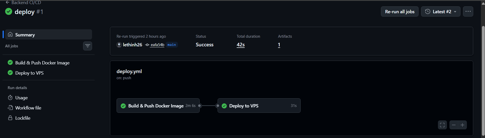

# BT05 - Nối Job tự động Build & Push Docker Image sau khi Test Gradle xanh

## 1. Nội dung tệp .github/workflows/ci.yml

Tách luồng CI thành 2 Job: `test` và `docker-build`, ràng buộc bằng `needs: test`:

```yaml
name: Java Spring Boot CI (Gradle)

on:
  push:
    branches: [ "main" ]

jobs:
  test:
    name: Run Unit Tests
    runs-on: ubuntu-latest

    steps:
      - name: Checkout mã nguồn
        uses: actions/checkout@v5

      - name: Thiết lập môi trường Java JDK 17
        uses: actions/setup-java@v5
        with:
          java-version: '17'
          distribution: 'temurin'
          cache: 'gradle'

      - name: Cấp quyền cho Gradle Wrapper
        run: chmod +x gradlew

      - name: Thực thi JUnit Test với Gradle
        run: ./gradlew test

      - name: Đóng gói tệp JAR với Gradle
        run: ./gradlew bootJar

      - name: Lưu trữ thành phẩm JAR Artifact
        uses: actions/upload-artifact@v4
        with:
          name: app-jar
          path: build/libs/*.jar

  docker-build:
    name: Build and Push Docker Image
    needs: test
    runs-on: ubuntu-latest

    steps:
      - name: Checkout mã nguồn
        uses: actions/checkout@v5

      - name: Đăng nhập vào GitHub Container Registry
        uses: docker/login-action@v3
        with:
          registry: ghcr.io
          username: ${{ github.actor }}
          password: ${{ secrets.REGISTRY_TOKEN }}

      - name: Build và Push Docker Image
        uses: docker/build-push-action@v5
        with:
          context: .
          push: true
          tags: ghcr.io/it209-k24-lephuthinh/ss11-bt05:latest
```

## 2. Push code lên nhánh main

```bash
devops@0310263186:~/demo$ git add .github/workflows/ci.yml
devops@0310263186:~/demo$ git commit -m "ci: tách job docker-build chạy sau job test"
[main 6f0b3d9] ci: tách job docker-build chạy sau job test
 1 file changed, 20 insertions(+)
devops@0310263186:~/demo$ git push origin main
To github.com:IT209-K24-LePhuThinh/SS11-BT05.git
   4a1c8e2..6f0b3d9  main -> main
```

## 3. Sơ đồ Job trên tab Actions

```text
Java Spring Boot CI (Gradle) #6
6f0b3d9 main

  Run Unit Tests                 Success   1m 10s
        |
        v
  Build and Push Docker Image    Success   1m 42s
```

## 4. Log Job docker-build

```text
Run docker/login-action@v3
  Logging into ghcr.io...
  Login Succeeded

Run docker/build-push-action@v5
  Building docker image from Dockerfile
  ...
  #12 exporting layers
  #12 exporting layers 4.8s done
  #13 pushing layers 3.1s done
  #14 pushing manifest for ghcr.io/it209-k24-lephuthinh/ss11-bt05:latest
  #14 pushing manifest for ghcr.io/it209-k24-lephuthinh/ss11-bt05:latest 1.2s done
  Build and push completed successfully
```

## 5. Kiểm tra khi JUnit Test thất bại

Sửa một test case cho sai kỳ vọng và push lại:

```bash
devops@0310263186:~/demo$ git add src/test/java/com/example/demo/DemoApplicationTests.java
devops@0310263186:~/demo$ git commit -m "test: cố ý làm đứt unit test"
[main 7b2e514] test: cố ý làm đứt unit test
 1 file changed, 1 insertion(+), 1 deletion(-)
devops@0310263186:~/demo$ git push origin main
To github.com:IT209-K24-LePhuThinh/SS11-BT05.git
   6f0b3d9..7b2e514  main -> main
```

Kết quả trên tab Actions:

```text
Java Spring Boot CI (Gradle) #7
7b2e514 main

  Run Unit Tests                 Failure   1m 08s
        |
        v
  Build and Push Docker Image    Skipped
```

Log bước test ở lần chạy này:

```text
Run ./gradlew test
> Task :compileTestJava
> Task :test FAILED

DemoApplicationTests > contextLoads() FAILED

BUILD FAILED in 26s
3 actionable tasks: 3 executed
```

Job docker-build chuyển trạng thái Skipped do ràng buộc `needs: test` không được thỏa mãn.

## 6. Ảnh chụp màn hình


